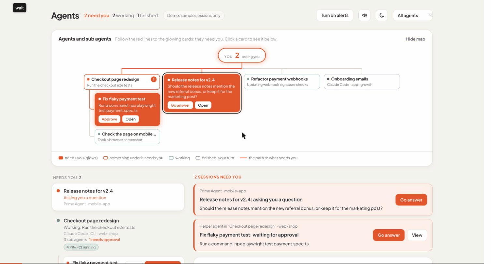

# Agents dashboard

One local page showing every AI agent session on this Mac and which ones are waiting on you.



**Needs:** macOS, Node 22.5 or newer, and (for the PR/CI section) the `gh` CLI signed in. No npm dependencies.

## Install as a Claude Code plugin (recommended)

In Claude Code:

```
/plugin install agents-dashboard --marketplace Aastha9018/agents-dashboard
```

On older Claude Code versions, add the marketplace first, then install:

```
/plugin marketplace add Aastha9018/agents-dashboard
/plugin install agents-dashboard@agents-dashboard
```

Then start a new Claude Code session and type `/agents-dashboard:dashboard` (or just ask "open the agents dashboard"). The page opens at http://localhost:4777 and keeps running in the background. Ask Claude to "stop the agents dashboard" to stop it.

The plugin also turns on the Notification hook (exact "waiting for permission" detection) for you.

## Run it without the plugin

```bash
git clone https://github.com/Aastha9018/agents-dashboard && cd agents-dashboard && npm start
```

Open http://localhost:4777.

## What it shows

**Agents and sub agents (top):** a tree chart. **You** sit at the top, each running agent hangs off you as a branch, and its sub agents are stacked under it.
- Anything that needs you is a **glowing coral card** with the question, an **Approve** / **Go answer** button, and **Open**.
- The lines from you down to it turn red.
- An agent whose sub agent needs you gets a coral outline and a count badge.
- Teal is working, purple is finished (your turn), grey is quiet.
- Click a card to open it in the panel below. **Hide map** collapses the chart, and that choice is remembered.

**Left:** every session, grouped as **Needs you**, **Working**, **Finished, your turn** and **Idle**. Sessions that are no longer running sit under "Earlier, not running". Click one to open it on the right.

Under each agent is the list of its **sub agents**:
- **Helper agents** it started with the Agent/Task tool (from `<transcript>/subagents/*.meta.json`).
- **Sessions it started** in the Claude app (the app's `spawnedFrom` link). These appear only under their parent, not as separate rows.

Each sub agent has two buttons:
- **Open** jumps to it. A helper agent lives inside its parent, so Open goes to the parent session.
- **Needs approval** turns coral when that sub agent is waiting on you, and jumps to where you approve it. Otherwise it's greyed out.

An agent moves to **Needs you** when any of its sub agents is waiting. Background helpers can't ask you anything, so they only count as waiting when their parent reports a permission prompt.

**Top right:** every session that needs you, pinned above whichever session is open, each with **Go answer** and **View**.

**Right:** the selected session:
- **Right now:** what it needs from you, what it's working on, or its last message, with a button that jumps to it.
- **Pull requests:** every PR related to the session: its branch's PR, PRs it created, pushed to or ran `gh pr` on (by link or number), PRs the Claude app linked to it, and PRs it wrote about in the same repos. Each shows one status (Draft, Ready for review, CI running, CI failed, Merge conflicts, Changes requested, Ready to merge, Merged, Deploying to staging, Deployed to prod, Deploy failed) and its journey: Opened → Ready for review → CI → Mergeable → Merged → Deployed. Deployments come from GitHub's deployment records (e.g. jobs with an `environment:`), shown per environment with links to the logs. Uses your `gh` login; refreshes every 30s while CI or a deploy is running.
- **What happened:** a flowchart of the session, oldest at the top. Each turn starts with what you asked, then the main points ("Looked through the code", "Made a plan with 5 steps", "Changed 3 files", "Committed", "Opened a pull request"), then its reply. The last item is where it stands now. Items fade in as you scroll.

**Go answer / Open** brings the right window to the front:
- Claude Code desktop sessions: opens that exact session in the Claude app (via its `claude://code/continue?session=local_…` link).
- Terminal sessions (Claude CLI, Prime, Codex): switches to the exact iTerm/Terminal tab, or brings VS Code/the host app to the front.
- Ended sessions: opens a new Terminal window with the resume command.

**Screenshots:** when a session checks UI work (browser or simulator screenshots), its turn shows a "Screenshots" row with thumbnails of the latest 8. Images you pasted into a message show under your prompt. Click one to see it full size (Esc to close). Claude Code sessions only.

The speaker button in the top right switches alerts between **sound** (default) and **silent**. It applies to browser alerts and to the macOS banner fallback, and is saved in `~/.agents-dashboard/settings.json` (start with `SOUND=0` to default to silent).

**Demo mode:** open http://localhost:4777/?demo=only to see only sample sessions (Codex, Prime Agent, sub agents, PRs in every state). It's safe for screen recordings because none of your real sessions show. Use `?demo=1` to mix the samples in with your real ones. Sample sessions are labelled and opening one does nothing.

The sun/moon button in the top right switches between light (default) and dark. Your choice is remembered.

## Alerts

An alert fires only when you have something to do:
- **Needs you:** a question, a plan to approve, a permission prompt, a decision or an error. Fires right away, and only when it's certain (no "maybe waiting" guesses).
- **Finished:** the agent really ended its turn (not a pause between steps) and stayed finished for 20 seconds.

Each alert has:

- **Title:** the agent (Claude Code · app, Claude Code · CLI, Codex, Prime Agent)
- **Session:** repo · session name
- **One line:** what it needs or what it finished ("Asks: …", "Needs approval: …", "Plan ready for your approval", "Done: …")
- **Buttons:** an action (Answer, Approve, Review plan, Reply, Open) that jumps to the session, and **Ignore**

To get the buttons, open http://localhost:4777 in Chrome and click **Turn on alerts** once. Keep that tab open (it can be in the background). The buttons take you to the session. They don't answer for you.

No alert fires for the session you're on: the one in the selected iTerm/Terminal tab, or, with the Claude app in front, the session open in the app (from the app's own last-focused record).

With no such tab open, alerts fall back to a plain macOS banner (title and session, no buttons). Clicking that banner opens Script Editor, which is a macOS limitation.

## Where the data comes from

| Agent | Live status | Transcript |
|---|---|---|
| Claude Code (CLI + app) | `~/.claude/sessions/<pid>.json` | `~/.claude/projects/<slug>/<id>.jsonl` |
| Prime Agent | `~/.prime/agent/session-leases/*/owner.json` | `~/.prime/agent/sessions/<id>.jsonl` |
| Codex | running `codex` process + recent rollout writes | `~/.codex/state_*.sqlite` → `~/.codex/sessions/**/rollout-*.jsonl` |

Everything is read-only. Only the last ~768 KB of each transcript is read.

## Options

```bash
PORT=5000 npm start          # different port
NOTIFY=0 npm start           # no macOS notifications
RECENT_HOURS=48 npm start    # longer "recent" window
```

## Exact permission-prompt detection for Claude Code (optional)

Claude Code doesn't record permission prompts in its files, so without the hook the dashboard guesses ("Maybe waiting for approval": a tool call pending 25s+, or 2 min+ for shell commands). Sessions started after the hook was installed never show a guess. The plugin installs this hook for you. Without the plugin, add it to `~/.claude/settings.json`:

```bash
npm run install-hook     # backs up settings.json first
npm run remove-hook      # undo
```

The hook writes a small JSON file to `~/.agents-dashboard/claude-notify/` whenever Claude Code shows a permission prompt. All of the dashboard's own state (hook signals, the share key, the server log) lives in `~/.agents-dashboard/` (override with `AGENTS_DASHBOARD_HOME`).

## Sharing a view-only link (e.g. with ngrok)

```bash
ngrok http 4777
```

Send `https://<your-tunnel>/?key=<key>`; the key is in `~/.agents-dashboard/share-key` and printed when the server starts. Visitors through a tunnel must have the key, and they are view-only: they can't open sessions on your Mac and never receive (or silence) your alerts. They do see your prompts and replies, so only share it with people you trust.

## License

MIT. See [LICENSE](LICENSE).
